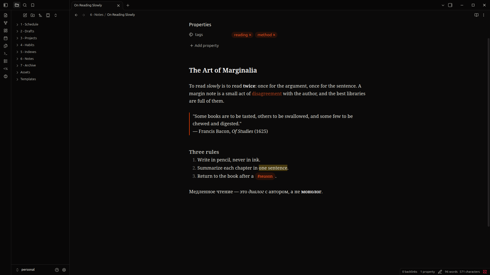

# Academic-Vibes

A near-black [Obsidian](https://obsidian.md) theme set in **Noto Serif**. Your notes won't get smarter, but they'll look like they did.

## Features

- **Noto Serif** for notes, titles and headings, bundled inside the theme. Nothing to install, and it works offline.
- Full **Latin and Cyrillic** support, with variable weights from regular to bold and a true italic.
- A **near-black** background, with sidebars a shade darker than the editor and soft hairline borders.
- A **burnt-orange accent** and the [Flexoki](https://stephango.com/flexoki) palette for colored text, callouts and highlights.
- The interface and code blocks keep Obsidian's default fonts, so the app stays crisp and familiar.

> [!note]
> Academic-Vibes is designed for **dark mode**. In light mode only the fonts change.

## Installation

### From Obsidian

1. Open **Settings → Appearance → Themes → Manage**.
2. Search for **Academic-Vibes**, then click **Install and use**.

### With BRAT (beta versions)

1. Install the [BRAT](https://github.com/TfTHacker/obsidian42-brat) community plugin.
2. In BRAT's settings, choose **Add beta theme** and enter `FLEYreal/academic-vibes-theme`.

### Manually

1. Download `theme.css` and `manifest.json` from the [latest release](https://github.com/FLEYreal/academic-vibes-theme/releases/latest).
2. Put them in `<your vault>/.obsidian/themes/Academic-Vibes/`.
3. Select **Academic-Vibes** in **Settings → Appearance → Themes**.

## Credits

- [Noto Serif](https://github.com/notofonts/latin-greek-cyrillic) by the Noto Project Authors, under the SIL Open Font License 1.1.
- Accent colors from [Flexoki](https://stephango.com/flexoki) by Steph Ango.

## License

The theme is released under the [MIT License](LICENSE).
The bundled Noto Serif font is **not** covered by the MIT License. It stays under the [SIL Open Font License 1.1](OFL.txt).
